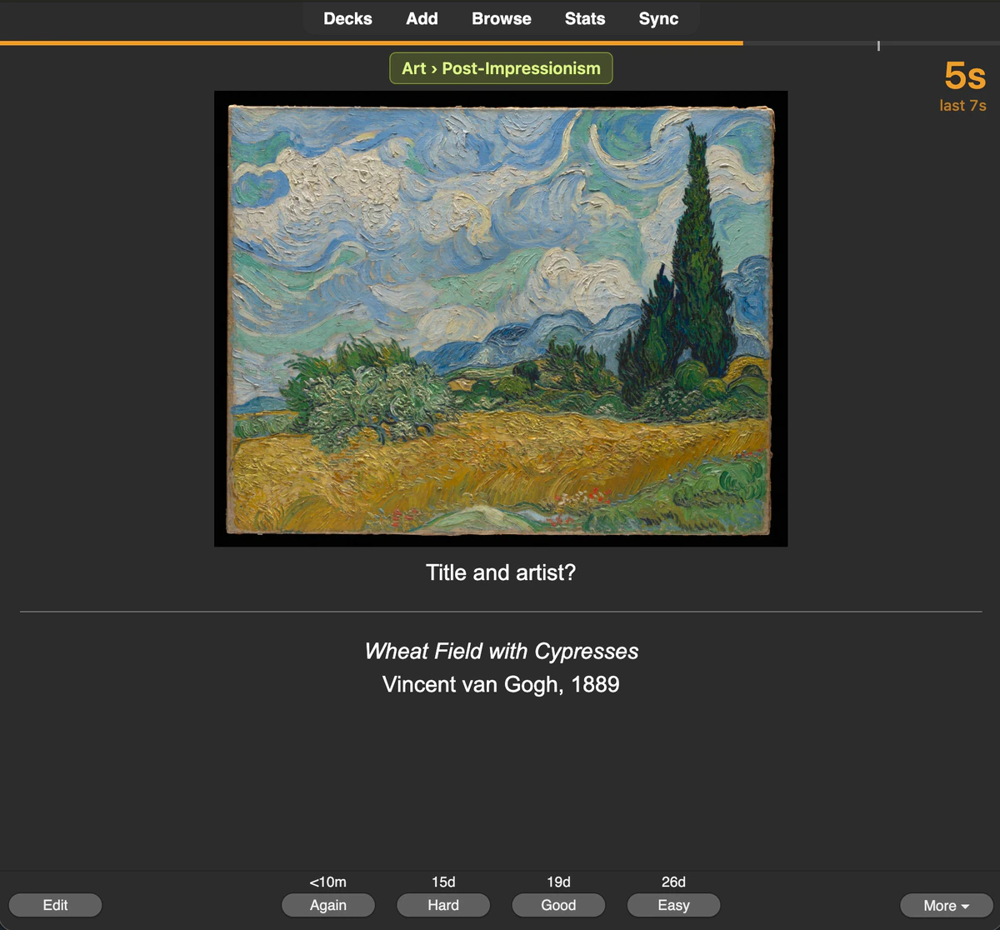
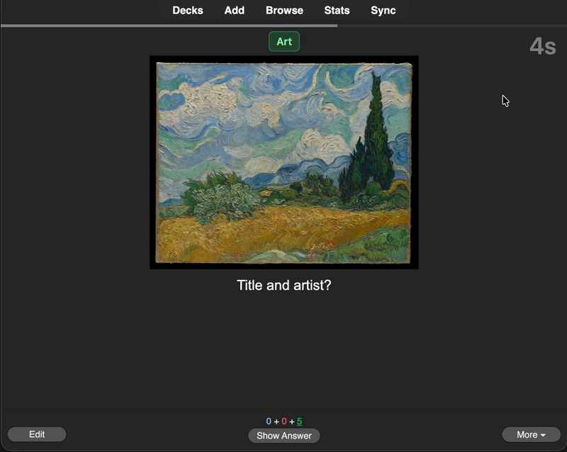

# Anki add-on: Card Timer & Deck Label

Anki comes built-in with [timer functionality](https://docs.ankiweb.net/deck-options.html#timers) which can optionally be paired with the [Auto Advance](https://docs.ankiweb.net/deck-options.html#auto-advance) feature. The problem this add-on addresses is that the timer itself is not at all prominent - the text is small and placed on the bottom-right corner of the review screen. This add-on makes the timer more prominent and also provides a customizable deck label for cards being reviewed, which can be helpful when reviewing from parent decks.

Some other timer add-ons build their own timer functionality into Anki, this one doesn't (just a visual change), which plays nicely with the built-in time-related Anki features. Designed to look like a native Anki feature.

  

## Installation

Requires Anki 23.12 or later, on Windows, macOS or Linux.

<!-- add the AnkiWeb code here once the add-on is listed there -->

1. Download `card_timer_deck_label.ankiaddon` from the [latest release](https://github.com/uoysip/anki-card-timer-deck-label/releases/latest).
2. In Anki, open **Tools > Add-ons**, click **Install from file…** and choose the file.
3. Restart Anki.

## Usage

- **Timer:** turn on Anki's [**Show on-screen timer**](https://docs.ankiweb.net/deck-options.html#on-screen-timer) option, found in a deck's options under **Timers**. The counter and time bar then appear at the top of every card in that deck.
- **Deck label:** appears on its own when you study a deck that has subdecks, naming the subdeck each card comes from.
- **Settings:** the add-on's own settings are under **Tools > Card Timer & Deck Label**.

**Note (deck label spoilers):** For some cards, the deck label can spoil the answer. To prevent that, right-click the label and [choose what it shows on each side of the card](SETTINGS.md#hiding-spoilers-in-the-deck-label).

Every setting is described in [SETTINGS.md](SETTINGS.md).

### Demo

  

## Features

- Display a **large seconds counter** using Anki's built-in card timer
- Show a **time bar** that fills toward a target time (turns amber, then red; colors can be configured/disabled)
- Support setting the **target time** as a fixed value, from your own pace in each deck, or from Auto Advance
- Report the **last answer time** for each card (shown under the counter and as a tick on the bar, on the answer side)
- Show a **deck label** for each card (colored per deck, configurable for the question and answer side)
- Support **per-deck rules** to (for example) shorten or hide a label that spoils the answer
- Allow **pausing the clock** while editing a card
- ***No network calls***, no changes to cards or scheduling

## License

This project is released under the MIT license, see the LICENSE file for details.
